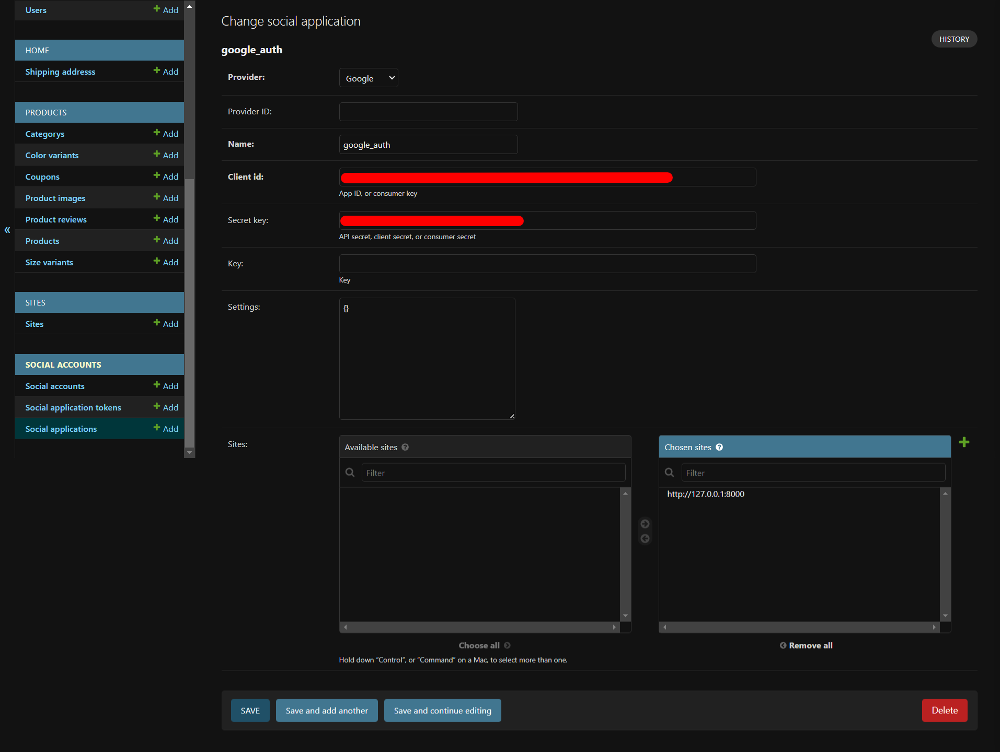

# BundleofGifts.com - One Stop Gifting Solution: A Django eCommerce Website


**BundleofGifts.com - One Stop Gifting Solution** is a full-fledged eCommerce website built with Django, a high-level Python web framework. It provides a robust, scalable, and user-friendly platform for a seamless online shopping experience. The project includes essential features like user authentication, product browsing, cart management, a secure checkout process with payment integration, and more.

## Table of Contents

- [Features](#features)
- [Technologies Used](#technologies-used)
- [Setup Instructions](#setup-instructions)
- [Troubleshooting](#troubleshooting)
- [Usage](#usage)
- [Contributing](#contributing)
- [License](#license)

## Features

- **User Authentication:** Secure user registration, login, password reset, and profile management.
- **Product Catalog:** Browse and search for products with detailed descriptions and images.
- **Shopping Cart:** Add, update, and remove items from the cart seamlessly.
- **Checkout Process:** A smooth checkout flow with an order summary and address management.
- **Payment Integration:** Integrated with Razorpay for secure online payments.
- **Order Management:** View order history and track status updates.
- **Returns and Refunds:** Request an eligible return from order details (or guest order tracking), submit carrier tracking and shipment photos after approval, and follow inspection and refund progress. Customers pay return shipping costs.
- **Replacements:** Eligible customers can choose a configurable replacement reason, upload photos of a wrong or damaged item, and follow admin review, replacement preparation, dispatch, and completion from the same order return page.
- **Responsive Design:** A mobile-friendly UI ensures a consistent experience across all devices.
- **Admin Panel:** Efficiently manage products, orders, and users through Django's admin interface.
- **URL-Based Images:** All images (products, categories, profiles) use URLs instead of file uploads, reducing storage requirements and enabling external image hosting.

## Technologies Used

- **Django:** A Python-based web framework for backend development.
- **HTML/CSS/JavaScript:** Frontend technologies for a responsive and interactive user interface.
- **Razorpay API:** A payment gateway integration for secure transactions.
- **Bootstrap:** A frontend framework for responsive design and UI components.

## Setup Instructions

To run this project locally, please follow these steps:

1.  **Clone the repository:**

    ```bash
    git clone https://github.com/prateek-chaurasia/ecomm
    cd ecomm
    ```

2.  **Create a virtual environment:**

    ```bash
    python -m venv venv
    ```

3.  **Activate the virtual environment:**

    - On Windows:
      ```bash
      .\venv\Scripts\activate
      ```
    - On macOS/Linux:
      ```bash
      source venv/bin/activate
      ```

4.  **Install dependencies:**

    ```bash
    pip install -r requirements.txt
    ```

5.  **Configure environment variables:**

    - Before running migrations, create a `.env` file in the project root. You can use `.env.example` as a template.
    - For local development, set `DEBUG=True`; local HTTP such as `http://localhost:8080` is allowed. For production, set `DEBUG=False`; production HTTPS hardening is then enabled by default.
    - Online payments are enabled by default outside production and shown as “Coming Soon” in production. Set `ONLINE_PAYMENT_ENABLED=True` to enable them explicitly, or `ONLINE_PAYMENT_ENABLED=False` to disable them in any environment.
    - GST/tax information is hidden from customer-facing pages and invoices by default. Set `SHOW_TAX_INFORMATION=True` in `.env` to show it again; this only changes what is displayed, not how order totals are calculated.
    - Invoice terms and conditions can be entered in the Django admin under Products > GST and invoice settings. Basic HTML is supported; unsafe tags and attributes are removed when the terms are printed.
    - Configure `PUBLIC_BASE_URL` with the public website URL used in customer-facing emails and tracking links:
      ```
      PUBLIC_BASE_URL=http://localhost:8080  # For local development
      PUBLIC_BASE_URL=https://bundleofgifts.com  # For production
      ```
      `BASE_URL` remains supported as a fallback for existing deployments.
    - Configure the order delivery area. It defaults to Dehradun; set it to `India` when ready to accept orders from anywhere in India:
      ```
      SERVICE_CITY=Dehradun
      # Later, change to:
      SERVICE_CITY=India
      ```
      While set to a city, orders to other cities are rejected during checkout. Serviceable pincodes remain available in the Django admin under `Accounts > Serviceable pincodes` for delivery-area tracking.
    - Shipping cities are stored locally and linked to their State. Existing address cities are migrated automatically. To import or extend the city catalog, prepare a UTF-8 CSV with `state,city` headers and run:
      ```bash
      python manage.py import_cities --file data/india_cities.csv
      ```
      State names must match the India states in the database. City duplicates that differ only by case, accents, spaces, or punctuation are merged per State.
    - Configure `ALLOWED_HOSTS` with your domain names (comma-separated, no spaces):
      ```
      ALLOWED_HOSTS=localhost,127.0.0.1,yourdomain.com
      ```
    - Configure the operations recipients for immediate new-order alerts. Multiple addresses can be comma-separated:
      ```
      ADMIN_EMAIL=orders@bundleofgifts.com,warehouse@bundleofgifts.com
      ```
    - To generate a `SECRET_KEY`, run the following in your activated virtual environment:
      ```bash
      django-admin shell -c "from django.core.management.utils import get_random_secret_key; print(get_random_secret_key())"
      ```
    - Copy the output and paste it into your `.env` file (e.g., `SECRET_KEY=your-secret-key-here`).

6.  **Apply database migrations:**

    ```bash
    python manage.py migrate
    ```

7.  **Create a superuser (admin):**

    ```bash
    python manage.py createsuperuser
    ```

8.  **Start the development server:**

    ```bash
    python manage.py runserver
    ```

9.  **Access the application:**
    - Open your web browser and navigate to `http://127.0.0.1:8000/`.

### Static asset caching

Static CSS, JavaScript, and image URLs use content-hashed filenames. After deploying changes to static assets, run `python manage.py collectstatic --noinput` and configure the production static-file server or CDN to send `Cache-Control: public, max-age=31536000, immutable` for `/static/`. Do not apply this long-lived policy to HTML responses or `/media/` uploads.

Frontend libraries and web fonts used by the site are stored locally under `public/media` and collected with the rest of the static files. Upstream license notices are retained with the vendored files; accompanying license texts are in `public/media/js/vendor/licenses/`. Razorpay's checkout script remains hosted by Razorpay as required for its payment integration. Serving local assets avoids third-party connection setup and lets the browser reuse the site's versioned static-asset cache; it does not reduce the libraries' transfer size.

## Troubleshooting

If you encounter issues during setup, here are some common problems and their solutions:

- **`Site.DoesNotExist` Error**: This error occurs when the `SITE_ID` in `ecomm/settings.py` does not match an entry in the database.

  - **Solution**: Ensure you have run the migrations (`python manage.py migrate`). If the error persists, inspect the `django_site` table in your database to find the correct ID for your site and update `SITE_ID` in `ecomm/settings.py` accordingly. Typically, this should be set to `1`.

- **`ModuleNotFoundError: No module named 'pkg_resources'`**: This indicates that the `setuptools` package is missing.

  - **Solution**: Install it using pip:
    ```bash
    pip install setuptools
    ```

- **Errors with `weasyprint` on macOS**: If you see an error like `OSError: cannot load library 'libgobject-2.0-0'`, it's because `weasyprint` is missing system-level dependencies.

  - **Solution**: Install the required libraries using Homebrew:
    ```bash
    brew install pango gdk-pixbuf libffi
    ```

- **Social Authentication Setup**: If you see errors on pages that require login, you may need to configure the social authentication settings.

  - **Solution**:

    1.  Navigate to the admin panel at `http://127.0.0.1:8000/admin/`.
    2.  Go to the "Social Accounts" -> "Social Applications" section.
    3.  Add a new social application (e.g., for Google) and provide your Client ID and Secret Key.

    

## Usage

- **Admin Panel:** Access the admin panel at `http://127.0.0.1:8000/admin/` to manage products, orders, and users. Update site-wide delivery copy under `Home > Delivery guideline` and return/refund/cancellation copy under `Home > Return and refund policy`. Product-specific return eligibility and conditions remain editable on each product.
- **Return processing:** Configure the return office address under `Home > Return and refund policy` before approving requests. Review and approve/reject requests under `Accounts > Return requests`; inspect shipment tracking and photos, record condition deductions, mark parcels received, then initiate a Razorpay refund or record a COD refund reference. Razorpay refunds can be refreshed from the admin list while the provider processes them.
- **Replacement processing:** Manage selectable reasons under `Accounts > Replacement reasons`. Review uploaded item photos in a replacement request, approve or reject it, then use the replacement preparation, dispatch (after entering the outbound tracking number), and completion actions in `Accounts > Return requests`. Replacements send the same item; they do not trigger refunds or ask the customer to ship it back.
- **Shopping:** Browse products, add items to the cart, proceed to checkout, and make payments using Razorpay.
- **User Profile:** Users can register, log in, reset their passwords, view their order history, and update their profiles.
- **Adding Images:** When adding products, categories, or updating your profile, use image URLs from external sources (e.g., image hosting services, CDNs, or direct URLs). The admin interface provides a URL input field for easy image management.

## Contributing

Contributions are welcome! Please fork this repository and create a pull request with your proposed features, enhancements, or bug fixes.

## License

This project is licensed under the [MIT License](LICENSE).
